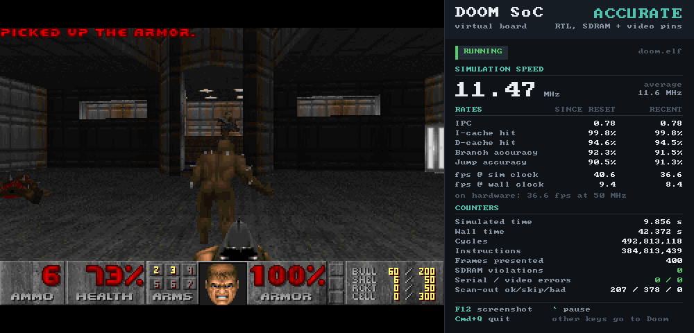

# Doom on a self-designed RISC-V CPU, in simulation

A 5-stage RV32IM CPU, caches, an SDRAM controller and a video block, written
from scratch in SystemVerilog, simulated cycle by cycle with Verilator, and
running Doom in a "virtual board" window. No operating system: everything
down to the C library is in this repository.



| | |
|---|---|
| Doom frames identical to native doomgeneric | 11 113 of 11 113 (three demos, pixel for pixel) on each of four engines |
| Frame rate at 50 MHz, real SDRAM timing | 45 fps |
| In the window | real time on the cycle-exact `model` engine; 13 / 10 fps on the RTL engines |
| Lockstep checks | 1.9 G instructions RTL vs golden model; 9.8 G RTL vs cycle-exact model, 0 deviations |
| CoreMark | 3.50 CoreMark/MHz |
| riscv-tests | 56 of 56 on every engine |
| Tang Nano 20K (Yosys + nextpnr) | fits, 46 of 46 block RAMs, Fmax 57–64 MHz vs a 50.4 MHz clock; never run on hardware |

## Run it

macOS on Apple silicon, Homebrew.

```sh
make setup                 # tools and third-party sources (doomgeneric, CoreMark, riscv-tests, shareware WAD)
make all                   # build everything
make doom ENGINE=model     # play, in real time at the hardware's exact speed
make test                  # every regression
make help                  # timedemo, coremark, isa, synth, ...
```

Engines: `model` (cycle-exact software model, real time), `fast` and
`accurate` (the RTL in Verilator), `iss` (instruction-set simulator).

## Read more

- [docs/OVERVIEW.md](docs/OVERVIEW.md): the machine, the virtual board, the software, how it was verified, results in detail
- [docs/ARCHITECTURE.md](docs/ARCHITECTURE.md): the interface contract everything was built against
- [docs/results/](docs/results/): timedemo counters, cache-size sweep, FPGA study
- `rtl/`, `sim/`, `sw/`, `tests/`, `synth/`: each directory's README is its documentation

doomgeneric (GPL-2.0), CoreMark (Apache-2.0), riscv-tests (BSD-3-Clause) and
the shareware WAD are downloaded by `make setup`, not redistributed. The Doom
patches in `sw/doom` are derived from doomgeneric and carry its licence.
