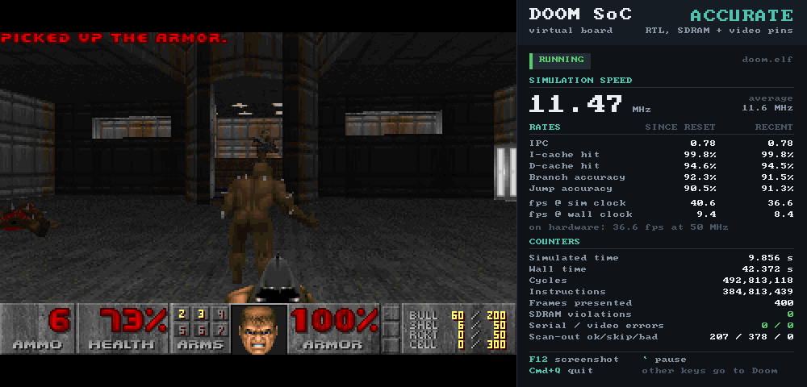
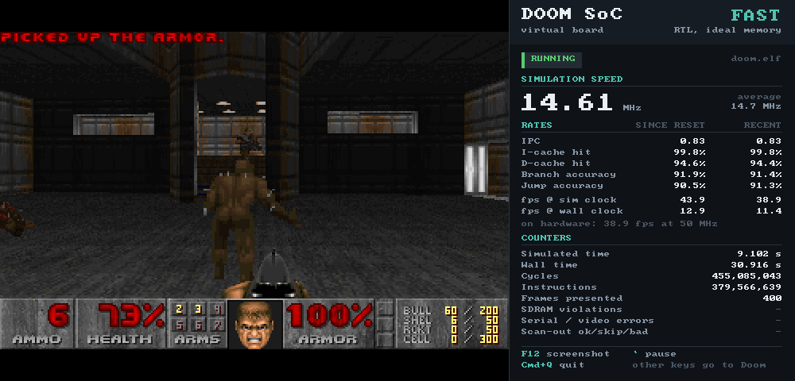
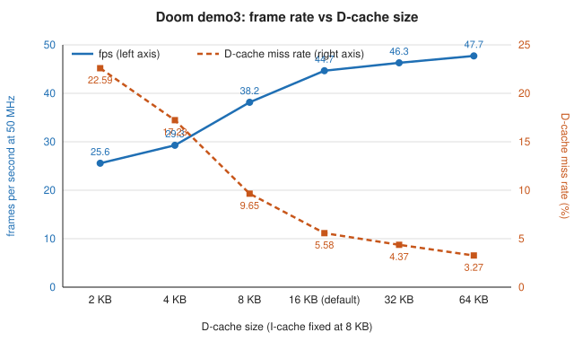

# Doom on a self-designed RISC-V CPU: overview and results

The long form of the top-level README: the machine, the virtual board, the software, how it was verified, and the results in detail.

A 5-stage RV32IM processor, caches, an SDRAM controller and a video block,
written from scratch in SystemVerilog, simulated cycle by cycle with Verilator,
and running Doom in a "virtual board" window on a laptop. No operating system:
the software stack down to the C library is part of this repository.



## Results

| | |
|---|---|
| Doom frames identical to native doomgeneric | **11 113 of 11 113** (the three shareware demos, every frame, pixel for pixel) on each of the four engines |
| Doom frame rate this design would reach at 50 MHz | **45 fps** (`-timedemo`, real SDRAM timing; 1.12 M cycles per frame; 44.1 / 45.7 / 44.7 on the three demos) |
| Doom in the window, wall clock | real time (the hardware's exact speed) on the cycle-exact model; 13 fps on the fast RTL engine, 10 fps on the accurate one |
| Instructions checked in lockstep against the golden model during a Doom demo | 1 916 516 616, no mismatch |
| Instructions checked in lockstep between the RTL and the cycle-exact model | 9.8 billion (all three demos), every one retiring in the same cycle, no deviation |
| SDRAM protocol/timing violations during the demos | 0 in 294 million row activations |
| CoreMark | 3.50 CoreMark/MHz (174.8 iterations/s at 50 MHz) |
| Official riscv-tests (rv32ui, rv32um, rv32mi subset) | 56 of 56, on the bare core, the golden model, both RTL engines and the model |
| Tang Nano 20K (Yosys + nextpnr, never run on hardware) | fits: 37 % of the LUTs, all 46 block RAMs; Fmax 57–64 MHz against a 50.4 MHz system clock |

Per-demo numbers are in [Results in detail](#results-in-detail). The machine
was first brought up with a plainer memory system and software (26 fps at
50 MHz); a performance pass then cut the cycles per frame by 42 % (software
31 %, hardware 15 %), made the RTL simulation 1.6× faster per cycle, added the
cycle-exact model, and removed 11 % of the repository's lines.

## The machine

```
              soc_top  (synthesizable; "the FPGA")
 +--------------------------------------------------------------------+
 |  rv32_core            memsys                                       |      virtual board (C++/SDL2)
 |  +---------+  I-port  +--------+ line                              |
 |  | IF ID   |--------->| icache |-----+    +------------+  SDRAM    |    +------------------+
 |  | EX MEM  |          +--------+     +--->| sdram_ctrl |<==pins===>|<==>| SDRAM chip model |
 |  | WB      |  D-port  +--------+     |    +------------+           |    +------------------+
 |  | bpred   |--+------>| dcache |-----+                             |
 |  | csr     |  |       +--------+                                   |
 |  +---------+  |   mmio                                             |
 |               +-->+------+ uart_tx ------------------------------->| serial decoder -> terminal
 |                   | uart |<--------------------- key events -------| SDL keyboard
 |                   | kbd  | hsync/vsync/de/rgb -------------------->| monitor model -> SDL window
 |                   | video|                                         |
 |                   +------+                                         |
 +--------------------------------------------------------------------+
```

**CPU** (`rtl/core`). RV32I + M + Zicsr + Zicntr, machine mode. Five stages
with full forwarding, a one-cycle load-use stall, and branches resolved in EX.
The branch predictor in IF is a 256-entry BTB with 1024 two-bit counters and an
8-entry return-address stack: a correctly predicted taken branch, call or
return costs nothing, a mispredict costs two cycles. Multiply takes two cycles
in a DSP block; divide is iterative and skips the quotient bits that must be
zero, so it costs 2 to 34 cycles depending on the operands (14 on average in
Doom). Exceptions are precise. The `mcycle` counter is the machine's clock:
Doom's timer is `rdcycle`.

**Memory system** (`rtl/mem`). An 8 KB instruction cache and a 16 KB
write-back data cache, both direct mapped with 32-byte lines, in front of an
SDRAM controller that speaks the real pin protocol (CAS latency 2, 8-beat
bursts, auto-refresh). A hit answers in the next cycle. A miss costs 7 cycles:
the line is fetched critical word first, the CPU resumes when its word arrives
and the rest of the line fills in the background while hits, including
sequential fetches streaming behind the beats, are served; a dirty victim is
copied into a write buffer and written back afterwards; stores that arrive
during a fill wait in a one-entry store buffer.

**Video** (`rtl/periph`). A 320×200 framebuffer of palette indices in block
RAM and a 256-entry palette. The scan-out generates 640×480@60 timing,
doubles every pixel, and looks each index up in Doom's palette on its way to
the pins.

**Also**: a serial transmitter, a register that keyboard events arrive in, and
a system-control block. The full register map, the CPU-to-memory bus protocol
and every module's port list are specified in
[ARCHITECTURE.md](ARCHITECTURE.md), which the RTL, the simulator and
the software were all written against. Each area's own README (next to its
code) holds its design decisions.

## The virtual board

`sim/vboard` wraps a model of the machine and gives it a screen, a keyboard,
a serial terminal and an instrument panel with live instructions-per-cycle,
cache hit rates, branch accuracy and frame rates. It loads the program and the
WAD straight into simulated memory, so there is no storage device to emulate.
The CPU's serial output is the program's stdout.

It drives four interchangeable engines:

| Engine | What runs | Memory | Video | Use |
|---|---|---|---|---|
| `fast` (default) | the RTL (Verilator) | ideal memory behind the same caches | the board reads the framebuffer out of the model | quick turnaround on the RTL |
| `accurate` | the RTL (Verilator) | SDRAM controller driving pins into a C++ model of the chip that checks every timing parameter | the real scan-out, captured from the pixel pins and checked against the framebuffer | every number in this README; correctness |
| `model` | the golden model's instructions with a cycle-exact software model of the accurate machine's timing (`sim/model`) | caches, write buffer, arbiter and SDRAM controller modelled cycle by cycle | framebuffer at each `VID_FLIP` | playing in real time at exactly the hardware's speed; the same counters as `accurate`, proven against it in lockstep |
| `iss` | the golden model: an instruction-set simulator of the same machine, one cycle per instruction | flat | framebuffer | software development, and the reference the RTL is checked against |

On one core of an Apple M5 the RTL engines simulate 14 million cycles per
second (`fast`) and 11 million (`accurate`), which is 13 and 10 Doom frames per
second of wall-clock time; the `model` engine simulates about 80 million cycles
per second, faster than the 50 MHz hardware, so with `--realtime` Doom plays at
exactly the FPGA's speed. Because every engine counts cycles, the frame rate
the hardware would reach is known exactly even where the simulation is slower
than real time. `vboard --engine accurate --cosim=model` runs the RTL and the
model side by side and compares every retired instruction, the cycle it
retires in and every counter; `--cosim` does the same against the golden model
(instructions only).



## The software

Nothing below `main` comes from outside this repository except the compiler's
own runtime (`libgcc`):

- `sw/bsp`: start-up code, linker script, console, clock, and a trap handler that
  prints the cause, a register dump and the code addresses on the stack over serial.
- `sw/libc`: a freestanding C library (printf family, malloc, string and stdio
  with read-only in-memory files) written for this project. It holds only what
  the programs here use and is tested against the host's C library with
  1.1 million comparisons.
- `sw/hello`, `sw/testpattern`, `sw/coremark`: the bring-up programs.
- `sw/doom`: [doomgeneric](https://github.com/ozkl/doomgeneric) plus seven
  small correctness patches, seven SoC-only performance patches and one
  platform file per build. The correctness patches are shared by both builds:
  natively (the reference) and for the SoC. The SoC build additionally copies
  the frame once instead of twice, draws columns and spans with tighter loops,
  divides fixed-point numbers exactly with two 32-bit divides instead of a
  64-bit library routine, and places its hot data and code so that they do not
  evict each other from the direct-mapped caches ([sw/doom/README.md](../sw/doom/README.md)).

One of the correctness patches fixes a real defect that the comparison would
otherwise have tripped over: Doom's column renderer can read past the end of a
short texture column, so that pixel depends on whatever follows the texture in
memory, and that differs between a 64-bit and a 32-bit build.

## How it was verified

Each layer is checked on its own before anything is trusted on top of it.

| Layer | Check | Size of the last run |
|---|---|---|
| CPU core alone | Lockstep against the golden model under randomized memory latency: riscv-tests and constrained-random programs | 98 million instructions, 5 latency modes; 33 of 33 injected RTL bugs caught, 3 predictor-only bugs harmless |
| Caches + SDRAM controller | Random traffic on both ports against a reference memory that also predicts the completion cycle of every access, with the SDRAM chip model checking every timing rule | 77 million operations, 6 configurations, 0 violations; 36 of 36 injected bugs caught |
| Peripherals | Register-level tests; every pixel of whole scan-out frames compared against the expected image; serial waveform decoded | 1.9 million checks |
| Golden model | riscv-tests plus directed tests of every device register and trap | 56 riscv-tests, 237 other checks |
| C library | Host comparison against the system C library; self-test on the target; Doom's fixed-point division against the 64-bit definition | 1.1 million host checks, 258 million division cases |
| Whole SoC | riscv-tests, hello, the libc self-test and CoreMark on both RTL engines in lockstep with the golden model, and the same plus directed corner cases in lockstep with the cycle-exact model | 490 checks |
| Doom, native vs golden model vs RTL vs model | Every frame of all three demos compared pixel for pixel with native doomgeneric | 11 113 frames per engine |
| Doom on the accurate engine | One whole demo in lockstep with the golden model, with the SDRAM checker and the scan-out check active | 1.92 billion instructions, 2.46 billion cycles |
| Cycle-exact model | All three demos in lockstep with the accurate RTL: retire record, retire cycle and all counters compared, no overrides | 9.8 billion instructions, 0 deviations |

"Lockstep" means that for every instruction the RTL retires, the golden model
executes one too, and the program counter, instruction, register write, memory
access and next PC must agree. "Scan-out check" means every complete frame that
comes out of the video pins while the framebuffer is not being written must
equal the framebuffer contents looked up through the palette (3 435 such
frames across the three demos, none different; fewer than before the pass
because frames now arrive faster than the scan-out).

## Results in detail

Doom `-timedemo` on the accurate engine (50 MHz clock, real SDRAM timing):

| Demo | Map | Frames | Identical to native | Cycles | IPC | I-cache hit | D-cache hit | Branch accuracy | fps at 50 MHz | Doom's own report |
|---|---|---|---|---|---|---|---|---|---|---|
| demo1 | E1M5 | 5065 | 5065 | 5.77 G | 0.786 | 99.8 % | 94.5 % | 91.3 % | 44.1 | 43.71 fps |
| demo2 | E1M3 | 3875 | 3875 | 4.26 G | 0.784 | 99.8 % | 94.3 % | 91.5 % | 45.7 | 45.20 fps |
| demo3 | E1M7 | 2173 | 2173 | 2.46 G | 0.779 | 99.8 % | 94.4 % | 91.4 % | 44.7 | 43.75 fps |

"fps at 50 MHz" is frames divided by simulated time from the first presented
frame to the last. "Doom's own report" is the line the game prints at the end
of a timedemo, computed from its cycle-counter clock; it counts game tics
rather than presented frames and includes level loading.

The `model` engine reproduces every one of these cycle counts exactly. The
fast engine draws the same 11 113 frames; with its ideal memory the same demos
need 7 % fewer cycles (IPC 0.84), which is the cost of SDRAM timing. Every
counter of every run is in [results/timedemo.md](results/timedemo.md).

Before the performance pass demo3 took 4.20 G cycles (26.1 fps at 50 MHz).
Of the 41 % saved, the software accounts for about three quarters (the
renderer's inner loops, the frame copy, the division routine and cache-aware
placement) and the memory system for the rest (miss cost 7 cycles instead of
15 or 26).

CoreMark (accurate engine, 2500 iterations, 14.3 simulated seconds):
174.82 iterations/s at 50 MHz = **3.50 CoreMark/MHz**, IPC 0.84, GCC 16.2
`-O2` with the unrolling and inlining flags listed in `sw/coremark/Makefile`.

### How much the caches matter

The same demo (demo3) on the accurate engine with different cache sizes. Every
configuration draws the same 2173 frames; only the number of stall cycles
changes.

| D-cache (I-cache 8 KB) | 2 KB | 4 KB | 8 KB | **16 KB** | 32 KB | 64 KB |
|---|---|---|---|---|---|---|
| fps at 50 MHz | 25.6 | 29.3 | 38.2 | **44.7** | 46.3 | 47.7 |
| D-cache miss rate | 22.6 % | 17.2 % | 9.7 % | **5.6 %** | 4.4 % | 3.3 % |

| I-cache (D-cache 16 KB) | 1 KB | 2 KB | 4 KB | **8 KB** | 16 KB | 32 KB |
|---|---|---|---|---|---|---|
| fps at 50 MHz | 38.4 | 43.0 | 43.8 | **44.7** | 44.9 | 45.0 |
| I-cache miss rate | 2.67 % | 0.82 % | 0.54 % | **0.21 %** | 0.15 % | 0.08 % |



The data cache dominates. Doom draws walls in vertical strips, so consecutive
pixel writes are 320 bytes apart, and the screen lines compete with texture
and table lines for the same sets of a direct-mapped cache: about 38 % of the
remaining misses are conflict misses that a two-way cache would remove, but
there is no block RAM left for a second set of tags. The defaults (8 KB +
16 KB) take the 13 block RAMs left after the framebuffer and the branch-target
buffer. Full tables: [results/cache-sweep.md](results/cache-sweep.md).

### FPGA study: Sipeed Tang Nano 20K

Yosys and nextpnr, run against the board's Gowin GW2AR-18 with a real board top
level (PLLs, the in-package SDRAM, DVI output over the HDMI connector), without
owning the board:

| Resource | Used | Of |
|---|---|---|
| LUT4 | 7 613 | 20 736 (37 %) |
| Flip-flops | 1 985 | 15 552 (13 %) |
| Block RAM | 46 | 46: framebuffer 32, D-cache 8, I-cache 4, cache tags 1, branch-target buffer 1 |
| LUT RAM sites | 231 | 648: register file, palette, branch history, return stack, dirty bits, write buffer |
| 36×36 multiplier | 1 | 12 |

System clock Fmax over five place-and-route seeds: **63.8 / 60.2 / 57.1 MHz**
(best / median / worst) against the 50.4 MHz target. The slowest path runs
from the cache tag RAM through the hit, ready and global-stall logic to the
framebuffer's write enable. The faster memory system cost about 1 500 LUTs and
6 MHz of worst-seed margin; a further cache change worth 1.4 % of cycles was
dropped because one seed failed to route with it.

How far to trust that number: this nextpnr build has no timing data for the
multiplier block and does not analyse one of the two address ports of the block
RAMs. The flow therefore routes the design twice with the RAM ports swapped
and quotes the worse result; the multiplier path remains unanalysed (routing
around it leaves 13.9 ns of the 19.8 ns cycle for the multiplier itself).

The design uses every block RAM on the device, which is what fixes the cache
sizes: the framebuffer alone takes 32 of the 46. Details, the per-module
breakdown and what a real board would still need (a program loader, storage
for the WAD) are in [results/fpga.md](results/fpga.md).

## Repository layout

```
ARCHITECTURE.md   the interface contract everything was built against; results/ measurements
rtl/core               the CPU                 rtl/mem     caches, SDRAM controller
rtl/periph             uart, keyboard, video   rtl/soc     top level
rtl/fpga               Tang Nano 20K top level and constraints
sim/vboard             the virtual board       sim/iss     golden model
sim/model              cycle-exact model of the accurate machine
sim/models             SDRAM chip, serial decoder, monitor (C++)
sim/common             program loader, frame dumps
sw/                    bsp, libc, hello, testpattern, coremark, doom
tests/                 isa (riscv-tests build), core, mem, periph testbenches
tools/                 frame comparison and export, cache sweep, report generator
synth/                 Yosys + nextpnr flow
scripts/               tool setup, third-party fetch, timedemo runner
```

Each directory's README is its documentation. `third_party/` (doomgeneric,
CoreMark, riscv-tests, the shareware WAD) and `.tools/` are fetched by
`make setup` and are not part of the repository.

## What this is not

- It has never run on hardware. The FPGA numbers come from the open-source
  Yosys/nextpnr flow, and the board top level is untested.
- The simulated SDRAM is 32 MB with the timing of the Tang Nano 20K's 8 MB
  part. The program (code, data, Doom's 6 MB zone, stack) is linked to fit the
  first 8 MB; the rest holds the WAD, which a real board would keep on flash
  or an SD card.
- No sound, no interrupts, no `fence.i` (code is never modified after load),
  and misaligned accesses trap rather than being emulated.
- The frame rates are `-timedemo` rates: the game renders as fast as it can.
  Interactive Doom caps itself at 35 fps, which this design now exceeds.
- The scan-out has a single framebuffer, so a real monitor would show tearing
  while a frame is being copied in. The pixel-for-pixel comparison is on the
  frames the program presents.
- The C library is a subset: a new program needing something none of the
  present programs use (`qsort`, `strtod`, ...) has to add it.
- The `model` engine is a prediction of the RTL's timing, kept exact by the
  lockstep check; when the RTL's timing changes, `sim/model` must follow.

## Third-party code

doomgeneric (GPL-2.0), CoreMark (Apache-2.0), riscv-tests (BSD-3-Clause) and
the shareware Doom WAD are downloaded, not redistributed here. The patches in
`sw/doom/patches` and `sw/doom/patches-soc` are derived from doomgeneric and
carry its licence.
