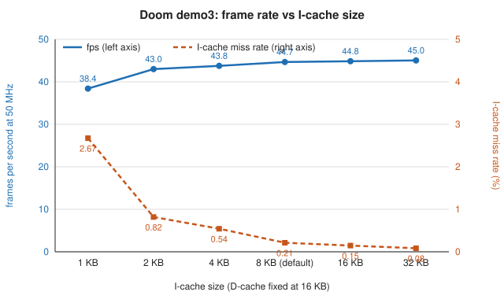
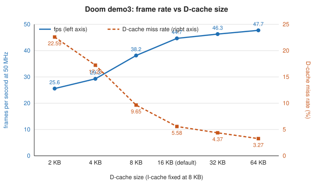

# Cache-size sweep: Doom frame rate vs I-cache and D-cache size

## What was measured and how

The SoC (5-stage RV32IM core, direct-mapped write-back I/D caches with 32-byte lines, SDRAM with real timing) was
simulated cycle-accurately in Verilator (`vboard --engine accurate`, `soc_top` FAST=0, C++ SDRAM chip model). The parameters
`ICACHE_BYTES` and `DCACHE_BYTES` were varied one cache at a time through the default point (I 8 KB / D 16 KB), plus two corner
points, and Doom's full `-timedemo demo3` (2173 frames) was run on each of the 13 resulting builds. Every run's frame dump was compared
with the native reference (`build/doom/ref/demo3.dfrm`) and the run was required to exit 0 with 0 SDRAM violations; the
dumps were deleted after comparison. fps is computed at 50 MHz over the span from the first to the last presented frame (cycles per
frame = (last - first frame cycle) / (frames - 1)); "Doom fps" is Doom's own `timed N gametics in M realtics` line, which
includes the start-up part of the demo and is therefore lower. Simulation is deterministic, so each figure is one run. Cache block RAM
counts are computed, not synthesized.

Charts: [fps and I-cache miss rate vs I-cache size](cache-sweep-icache.svg), [fps and D-cache miss rate vs D-cache size](cache-sweep-dcache.svg).




## Results

<!-- BEGIN GENERATED TABLES (tools/sweep/report.py) -->
### I-cache sweep (D-cache 16 KB)

| I-cache | D-cache | Cycles | Instructions | IPC | I miss | D miss | Cycles/frame | fps @ 50 MHz (vs default) | Doom "fps" | Frames = reference, exit 0, 0 SDRAM violations | Cache block RAMs |
|---|---|---:|---:|---:|---:|---:|---:|---:|---:|:---:|---:|
| 1 KB | 16 KB | 2,856,912,835 | 1,916,515,436 | 0.671 | 2.67 % | 5.58 % | 1,301,783 | 38.41 (-14.0 %) | 37.62 | yes | 10 |
| 2 KB | 16 KB | 2,554,833,867 | 1,916,517,061 | 0.750 | 0.82 % | 5.58 % | 1,162,998 | 42.99 (-3.7 %) | 42.1 | yes | 10 |
| 4 KB | 16 KB | 2,510,139,349 | 1,916,519,926 | 0.764 | 0.54 % | 5.58 % | 1,142,657 | 43.76 (-2.0 %) | 42.85 | yes | 11 |
| 8 KB | 16 KB | 2,458,661,186 | 1,916,521,883 | 0.779 | 0.21 % | 5.58 % | 1,119,626 | 44.66 (+0.0 %) | 43.75 | yes | 13 |
| 16 KB | 16 KB | 2,448,028,189 | 1,916,523,451 | 0.783 | 0.15 % | 5.58 % | 1,114,869 | 44.85 (+0.4 %) | 43.93 | yes | 17 |
| 32 KB | 16 KB | 2,437,935,153 | 1,916,524,429 | 0.786 | 0.08 % | 5.58 % | 1,110,286 | 45.03 (+0.8 %) | 44.11 | yes | 25 |

### D-cache sweep (I-cache 8 KB)

| I-cache | D-cache | Cycles | Instructions | IPC | I miss | D miss | Cycles/frame | fps @ 50 MHz (vs default) | Doom "fps" | Frames = reference, exit 0, 0 SDRAM violations | Cache block RAMs |
|---|---|---:|---:|---:|---:|---:|---:|---:|---:|:---:|---:|
| 8 KB | 2 KB | 4,277,950,722 | 1,916,521,180 | 0.448 | 0.21 % | 22.59 % | 1,955,425 | 25.57 (-42.7 %) | 25.06 | yes | 6 |
| 8 KB | 4 KB | 3,739,307,305 | 1,916,521,421 | 0.513 | 0.21 % | 17.23 % | 1,707,973 | 29.27 (-34.4 %) | 28.69 | yes | 7 |
| 8 KB | 8 KB | 2,874,428,784 | 1,916,521,561 | 0.667 | 0.21 % | 9.65 % | 1,310,514 | 38.15 (-14.6 %) | 37.38 | yes | 9 |
| 8 KB | 16 KB | 2,458,661,186 | 1,916,521,883 | 0.779 | 0.21 % | 5.58 % | 1,119,626 | 44.66 (+0.0 %) | 43.75 | yes | 13 |
| 8 KB | 32 KB | 2,371,680,579 | 1,916,521,947 | 0.808 | 0.21 % | 4.37 % | 1,080,139 | 46.29 (+3.7 %) | 45.34 | yes | 21 |
| 8 KB | 64 KB | 2,300,597,910 | 1,916,522,138 | 0.833 | 0.21 % | 3.27 % | 1,047,637 | 47.73 (+6.9 %) | 46.76 | yes | 37 |

### Corner points (and the default for reference)

| I-cache | D-cache | Cycles | Instructions | IPC | I miss | D miss | Cycles/frame | fps @ 50 MHz (vs default) | Doom "fps" | Frames = reference, exit 0, 0 SDRAM violations | Cache block RAMs |
|---|---|---:|---:|---:|---:|---:|---:|---:|---:|:---:|---:|
| 2 KB | 4 KB | 3,837,196,998 | 1,916,516,951 | 0.499 | 0.82 % | 17.23 % | 1,752,132 | 28.54 (-36.1 %) | 27.97 | yes | 4 |
| 8 KB | 16 KB | 2,458,661,186 | 1,916,521,883 | 0.779 | 0.21 % | 5.58 % | 1,119,626 | 44.66 (+0.0 %) | 43.75 | yes | 13 |
| 32 KB | 64 KB | 2,279,981,995 | 1,916,524,604 | 0.841 | 0.08 % | 3.27 % | 1,038,345 | 48.15 (+7.8 %) | 47.18 | yes | 49 |

Cache block RAMs = I-cache KB/2 + D-cache KB/2 data blocks (2 KB per 18 kbit block, rounded up) + 1 for the tags of both caches (computed, not synthesized). The device has 46 block RAMs in total; outside the caches the design uses 33 (framebuffer 32, branch-target buffer 1), leaving 13 for cache data and tags.

Default point reproduces the baseline cycle count (2,458,661,186): **yes**.
All 13 configurations ok (reference-identical frames, exit 0, 0 SDRAM violations, 2173 frames): **yes**.
<!-- END GENERATED TABLES -->

## Findings

I-cache: going from 1 KB to 8 KB raises the frame rate from 38.41 to 44.66 fps (I miss rate 2.67 % to 0.21 %); the knee is at 2 to 4 KB, where
4 KB is already within 2.0 % of the default. Beyond 8 KB the gain is small: +0.4 % at 16 KB and +0.8 % at 32 KB (miss rate 0.08 %).
D-cache: the effect is larger and has no clean knee. 2 KB gives 25.57 fps (-42.7 %), 8 KB 38.15 fps (-14.6 %), and each doubling above the default adds
less: +3.7 % at 32 KB and +6.9 % at 64 KB (D miss rate 5.58 % at 16 KB, 4.37 % at 32 KB, 3.27 % at 64 KB).
Against the largest caches (I 32 KB / D 64 KB: 48.15 fps, 2,279,981,995 cycles, IPC 0.841) the default (44.66 fps, IPC 0.779) leaves 7.8 % in
frame rate, of which most comes from the D-cache. The smallest corner (I 2 KB / D 4 KB) runs at 28.54 fps, 36.1 % below the default and
40.7 % below the largest point. Instruction counts differ by under 0.001 % between configurations (the program's execution does not depend on the cache); the
differences are all stall cycles.

Compared with the sweep before the performance pass (default 26.07 fps, largest point 29.37 fps): the miss rates of the
default point are slightly higher (the software now does less work per frame around the same number of misses), but a
miss costs 7 cycles instead of 15 or 26, so the spread between the smallest and the largest configuration has narrowed
from 44.7 % to 40.7 % and the gap from the default to the largest point from 12.7 % to 7.8 %.

## Reproduce

```
tools/sweep/run.sh 6        # builds the 13 variants into build/sweep/<name>/, runs and checks them (6 in parallel),
                            # then runs tools/sweep/report.py
python3 tools/sweep/report.py   # tables, charts and build/sweep/results.json only, from existing runs
```

Prerequisites: `build/doom/soc/doom.elf`, `build/doom/ref/demo3.dfrm`, `build/tools/framecmp`, `third_party/wad/doom1.wad`. Configurations are in
`tools/sweep/configs.txt`. Each variant is built by
`make -C sim/vboard OUT=$PWD/build/sweep/<name> VL_GEXTRA="-GICACHE_BYTES=<bytes> -GDCACHE_BYTES=<bytes>"` (no PGO) and run as
`build/sweep/<name>/vboard --engine accurate --headless --wad third_party/wad/doom1.wad --dump-frames F --stats-json J build/doom/soc/doom.elf -- -timedemo demo3`.
Raw results: `build/sweep/results.json`, `build/sweep/runs/<name>/`.
